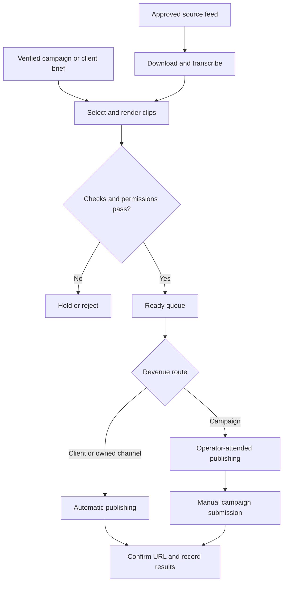

# Automated Clipping Business — Four-Day MVP Implementation Plan

Revised 18 November 2026, America/Toronto. Replaces the earlier volume-first architecture.

**Status:** researched implementation plan, not a deployed or tested application. Prices and capabilities below were checked against public official documentation; no destination account, campaign eligibility, private integration or earnings has been verified in a signed-in account.

## 1. Decision and achievable outcome

Build one small, single-owner Python application that turns authorized recordings into captioned clips, publishes through one supported integration, and records costs and earnings. Start with **one destination, one source format, one or two approved campaigns or one contracted client, and 1–3 clips total per day**. Keep the MVP within **US$15–35/month in incremental operating costs**, with a proposed **US$40/month operating ceiling**. These are planning allowances, not provider quotations or spending authorization. Existing coding subscriptions, development labor, taxes and campaign fees are separate.

An experienced developer working with Codex/Claude Code can target approximately **28–32 focused hours over four days** for this narrow pilot. A beginner may take longer. Account verification, campaign admission, source access, branded-content permissions, provider approval and customer acquisition are external dependencies; they cannot be promised within four days. Live operation is conditional on passing the launch tests in section 14.

**The central constraint:** Content Rewards currently documents no API and requires timely manual submission of published links. Its campaign mode therefore needs recurring human participation. Initial setup alone cannot make this route fully unattended. If recurring submission is unacceptable, prioritize authorized direct-client publishing or an owned original-content channel, and disable Content Rewards campaign publishing until an approved integration actually exists. [S1–S2]

The engineering objective is to increase **settled net contribution per operator hour**, subject to quality, permission, platform and cash limits. No software can guarantee maximum profit, viral reach, approval or customers.

## 2. Business model and priority

| Route | Revenue basis | Automation fit | MVP decision |
|---|---|---|---|
| Direct creator/business client | Agreed fee for bounded deliverables | Best fit for unattended production after access and editorial rules are agreed; sales, contracts and exceptions remain human | Preferred if a client is already available; do not assume one can be acquired in four days |
| Paid clipping campaigns | Campaign-specific CPM, approved-post fee, retainer or pool | Production can be automatic; admission, current terms, submission and settlement may require people | Small, supervised revenue experiment; one or two campaigns only |
| Owned social channel | Future eligible ads, sponsors or affiliate conversions | Publishing can be automatic; original creative work, eligibility, sponsorships and revenue setup are separate | Grow gradually; budget zero platform-ad income until it is actually enabled |

For direct clients, define included source hours, clip quantity, supported destinations, one visual template, revisions, approval turnaround, authorized media use and payment terms. Quote only after measuring work on a sample; a flat unlimited-edit offer can lose money. A useful internal price floor is allocated hosting + variable processing + operator hours valued at the owner's chosen rate + desired margin. This is a costing method, not a market-rate claim.

Do not develop three separate products. Use one pipeline with a `revenue_route` field. Choose campaigns/clients manually at first, then let software rank the selected, verified opportunities. There is no assumed automated Content Rewards marketplace feed or live budget endpoint.

## 3. Verified constraints and resulting decisions

| Finding from official documentation | Implementation consequence |
|---|---|
| Content Rewards requires a connected verified account and a public post submitted within 30 minutes; pre-approval campaigns require draft review first. [S1] | Campaigns use an operator-attended publish session and a deadline task; ordinary scheduling alone is insufficient |
| Content Rewards says an API is unavailable. [S2] | No invented REST endpoints, automated logins, scraping behind sign-in, or browser bots as the production dependency |
| CPM/pool creator fees are 10%; per-post/retainer fees have a qualifying campaign-budget exemption. [S3] | Store fees per campaign; do not hardcode one fee for every payout model |
| Campaigns differ in rates, payout limits, review and earning windows. [S3–S4] | Snapshot the actual brief and terms; leave unknown earnings as unknown |
| Buffer offers a current API on Free, with 1,000 requests per connected channel per 30 days, capped at 3,000 overall; other rate windows also apply. [S5–S6] | One account can support a small pilot if calls are budgeted; never poll every minute all day |
| Buffer Free permits three channels and ten queued posts per channel. [S7] | Connect one destination initially and retain most ready clips in our own queue |
| Buffer distinguishes automatic publication from a manual reminder, exposes post status and external links, and fetches video from a public URL. [S8–S10] | Confirm automatic mode and published URL on the actual account; host only final publishable media |
| Buffer's help page still describes metrics as experimental and unsuitable for dependable production reporting. [S5] | Metrics are optional hints; settlement records remain the earnings source of truth |
| TikTok Direct Post has a typically approximately 15-post/day creator limit, audits and creator-control requirements; private uploader utilities and arbitrary cross-platform copying are excluded use cases. [S11] | TikTok is deferred until the actual integration and use case pass verification; Buffer does not bypass its rules |
| YouTube reused-content monetization rules apply separately from copyright permission. [S12] | Permission and captions alone do not establish eligibility for YouTube ad revenue |

**Disclosure gate:** The Buffer Instagram metadata documentation reviewed does not establish support for every required paid-partnership control. Treat that capability as unverified. If a campaign requires a native label the chosen adapter cannot demonstrably set, block automatic publication for that campaign. Use a supported native/manual flow or select another suitable campaign/destination; a caption hashtag is not automatically a substitute. Meta documents a separate branded-content publishing path and permissions, but implementing and approving it is outside this four-day MVP. [S13–S14]

## 4. Scope that fits four days

### Included

- One owner, one Linux host and one publish adapter: Buffer, subject to account testing.
- One source connector: a creator-provided HTTPS JSON feed of downloadable recordings. An upload/inbox fallback works but is explicitly semi-manual.
- A small form to enter a campaign/client brief, rights evidence, selected account, limits and payment rules.
- CPU transcription, Claude-assisted clip selection and caption/title drafting, one fixed vertical editing template.
- Deterministic technical checks plus a short initial human calibration batch.
- Durable jobs, no duplicate publication, pause/resume, bounded retries and owner alerts.
- Campaign submission helper with live URL, deadline, campaign link and confirmation field; it does not submit to Content Rewards.
- Manual earnings entry and a documented local CSV import format, with profitability calculations.
- A basic authenticated dashboard and CSV export. No separate frontend application.

### Deferred

Live capture; automatic scraping of arbitrary YouTube/Twitch/Kick channels; automatic campaign enrollment; Content Rewards submission/status APIs; automatic invoicing or withdrawals; multi-user SaaS; mobile app; Kubernetes; Redis/Celery; advanced tracking of moving subjects; model training; automated sales outreach; fully autonomous ad-revenue optimization; three-platform launch.

Use available authorized recordings now. The application must not depend on a future game release or on GTA-specific footage existing.

## 5. Minimal architecture



| Component | MVP choice | Reason |
|---|---|---|
| App/dashboard | Python, FastAPI, server-rendered HTML | One codebase and a small administrative interface |
| Database/jobs | SQLite on local SSD, WAL enabled, migrations | Adequate for one host and one heavy worker; avoids a database subscription |
| Scheduler | Lightweight persistent database job loop | Due jobs survive restart; avoid relying on in-memory timers |
| Transcription | faster-whisper CPU, small/base int8 model chosen by benchmark | No GPU rental; word timing supports subtitles [S15] |
| Editorial model | One configurable economical Claude API model | Transcript-first analysis, optional candidate frames; no agent loop |
| Renderer | FFmpeg/ffprobe with ASS subtitles | Repeatable cuts, layout, captions and audio handling |
| Publishing | Buffer API | Existing account integration avoids building three platform adapters |
| Media | Local private working files; public opaque HTTPS URLs only for finished clips | Avoid a paid media service in the initial design |
| Hosting | One available x86 Linux VPS, starting around 2 vCPU/4 GB RAM | Benchmark serial processing before choosing/upgrading hardware |
| Alerts | One owner-only notification channel with a tested delivery path | Deadline reminders and exceptions; never posts to client contacts automatically |

Use separate lightweight app/scheduler and heavy-worker processes under a service manager or Docker Compose, with restart policies. Only one transcription/render job runs at once. Keep publication/status handling responsive during processing. SQLite transactions must be short: reserve a job, commit, then perform network/FFmpeg work. Never hold a database write transaction throughout rendering. Move to PostgreSQL only when measured concurrency or multi-host needs justify it.

Codex/Claude Code are development tools. Claude API is the bounded runtime editorial service. The application continues independently when the editor and chats are closed. This plan does not require two model subscriptions or two model calls for every decision.

## 6. Inputs and data contract

### Campaign or client configuration

Capture `id`, `revenue_route`, source/campaign URL, owner contact, permission evidence, terms text/file, `terms_version`, `verified_at`, `expires_at`, account/platform eligibility, required tags/mentions/disclosures, permitted audio, duration/layout limits, prohibited material, reuse/exclusivity constraints, allowed publication dates and approval requirements.

Payment fields: currency; model (`cpm`, `per_post`, `retainer`, `pool`, `client_fee`, `unmonetized`); rate; qualifying-view definition; minimum payable threshold and its semantics; maximum per clip/account/campaign; reported remaining budget with timestamp; earning-window rules; fee rate/exemption evidence; payout schedule; submission deadline; and evidence source. Never infer missing economic terms from another campaign.

Claude can turn pasted terms into a proposed schema, with evidence excerpts and unresolved questions. A human must confirm this configuration before it controls posting. New or changed terms invalidate the previous approval and revalidate unposted clips. The database snapshot is not a live guarantee of remaining campaign funds.

For Content Rewards, refresh campaign eligibility/status/budget during each attended publish session. Discovery and economic comparisons can run on entered data, but stale or missing terms cannot qualify a post for automatic release. Direct-client rule freshness follows the contract and its expiry.

### Source feed

Example of a feed under the creator's control, not a claimed third-party endpoint:

```json
{
  "videos": [{
    "id": "recording-001",
    "download_url": "https://creator-owned.example/media/recording-001.mp4",
    "title": "Approved recording",
    "rights_ref": "agreement-001"
  }]
}
```

Poll every 30 minutes; process each stable source ID once. Validate destination host and redirects, file size, media type and available disk. A public channel link discovers content but does not itself grant downloadable access. If a creator cannot supply this feed or a documented equivalent, manually add authorized links and label source ingestion semi-manual. Do not spend the four-day build reverse-engineering a streaming platform.

### Persistent records

| Table | Essential fields |
|---|---|
| opportunities | Route, current approved terms version, payment rules, eligibility, budget observation and timestamp |
| sources | Provider ID, rights reference, file hash, duration, transcript path, processing cost |
| clips | Source ID, timestamps, terms/template/model versions, candidate evidence, render path/hash, check results |
| publications | Clip/account, local intent ID, provider ID, status, scheduled/sent times, live URL, disclosure settings |
| submissions | Campaign, publication, deadline, submitted timestamp, external receipt/evidence, review state |
| ledger | Currency, amount, event type, external transaction ID, source evidence, effective date |
| jobs | Type, payload reference, due time, lease, attempts, error classification |

Use integer minor currency units or decimal arithmetic. Keep different currencies separate unless an explicit dated FX rate is entered. Never add USD and CAD as if they were the same currency.

## 7. Processing and editorial workflow

1. **Eligibility first:** Confirm permitted source, valid terms and compatible destination before incurring model/render cost. Campaign selection is bounded to the verified opportunities list.
2. **Acquire once:** Download to a private working directory. Hash content; reuse existing transcripts for identical media. Default daily acquisition/analysis budget: 30 source minutes, approximately 15 hours/month. Longer sources wait for an explicit limit change or a permitted selected excerpt.
3. **Transcribe once:** Use timed words and voice-activity filtering. Keep music/silence from becoming fabricated captions. Poor audio or unsupported language moves to review; do not auto-approve invented words.
4. **Generate candidates:** Analyse overlapping transcript windows. Return up to six candidate ranges with an evidenced hook and payoff. Validate bounds against actual duration. For gameplay, inspect a few frames near shortlisted moments; acknowledge that sparse frames and transcripts can miss silent action.
5. **Rank:** Score clarity, context, complete payoff, distinctness and campaign fit. Weights are configurable editorial heuristics, not calibrated probabilities of virality or approval. Choose at most the daily clip cap, with no minimum obligation to fill slots.
6. **Render one template:** Normally 1080 × 1920 H.264/AAC, 30 fps, with captions in safe margins. Set campaign-specific lengths. A gaming source uses a fixed gameplay/facecam layout calibrated at onboarding; a changed source resolution/layout causes a hold. Do not attempt general automatic speaker tracking in four days.
7. **Preserve originality and context:** Hooks must describe the source accurately. Required attribution is retained. Meaningful original commentary, when required for the business route, needs its own editorial work; automatically cropping and captioning is not proof of original content or monetization eligibility. Default to approved original audio with no added licensed music.
8. **Check:** Decode the full output; verify duration, dimensions, audio presence, no excessive black/frozen intervals, subtitle times and required literal tags. Exact hashes, source-range overlap and a simple sampled-frame/transcript similarity check flag duplicates. Similarity thresholds require calibration and cannot guarantee detection of every near-duplicate.
9. **Release:** Review the first 5–10 representative outputs. Thereafter automatically release only known-template clips meeting all configured gates. Uncertain context, unsupported disclosure, changed terms or a failed check stays held. AI review assists; it is not legal clearance or guaranteed campaign approval.

Published creative and captions become immutable within this system once submitted to a campaign. Necessary corrections route to an exception task; automatic experiments must not edit monetized posts in place.

## 8. Publishing, campaign submission and deadlines

### Mode A — unattended client/owned publishing

After initial account and rule verification, publish eligible clips from the durable queue at approved times, initially 1–3 daily total. The local scheduler owns release. Do not pre-fill a second independent schedule in Buffer; submit just-in-time so a local pause remains effective. Confirm the adapter uses automatic publishing, not notifications. Require a real publication result and URL before marking success.

If the publisher has already accepted a job, a local pause cannot guarantee cancellation. Expose accepted/in-flight jobs separately and use documented cancellation only when supported. Never imply a local status change removes an already published social post.

### Mode B — attended Content Rewards session

1. Prepare and check clips beforehand; hold them locally.
2. The owner checks current campaign terms, admission, remaining budget and disclosure requirements, then selects an already-reviewed clip and confirms availability. Record a short-lived readiness acknowledgement; expire it after five minutes if publishing has not started.
3. Publish one clip, wait for the real live URL and notify the owner immediately with the campaign page, URL and a countdown. Where the current adapter exposes them, use its `sentAt` and `externalLink` fields. A provider job ID is not a social post URL. [S8]
4. Calculate the deadline from actual public publication time, not from the scheduled time or when the app happens to notice it. If exact time is unavailable, use the earliest plausible send time conservatively and alert immediately.
5. The owner submits the URL on Content Rewards and records the confirmation/receipt. Aim to finish within ten minutes, leaving margin before the platform's deadline. Timely submission is distinct from eventual approval. [S1]
6. Remind on an unconfirmed submission at five and fifteen minutes. Escalate at twenty minutes; mark overdue at the true deadline. Missing alert delivery blocks the next publication. Do not auto-delete, re-upload or reassign the post to another campaign to recover a missed deadline.
7. Publish the next campaign clip only after the preceding submission is confirmed and readiness is renewed. Pre-approval campaigns also require recorded draft approval for that exact render/account before step 3.

This intentionally adds a recurring action. Estimate 5–15 minutes per attended session as a workflow target, then measure actual time; it is not a guarantee. If the owner is unavailable, the system prepares clips but does not publish campaign work.

### API request budget

On a one-channel Free allowance of 1,000 requests/30 days, a provisional budget is 90 creates + up to 540 publication-status queries + 60 batched housekeeping/optional metrics queries = **690 requests**, leaving approximately 310 for setup, retries and exceptions. This assumes at most three posts/day and at most six initial status queries per post. Query near send time, for example at 15, 45, 90, 180, 300 and 600 seconds. When unresolved, stop automated release and use the reserve/owner to investigate. Do not silently let deadline-sensitive work remain unattended. Respect the live API rate-limit headers and any SDK batching costs. [S6]

Do not rely on webhooks unless they are documented, available for this account and tested. Batch metrics by day rather than polling every clip constantly. Disable optional analytics before consuming the publishing/reconciliation reserve.

### Automation boundary

| Task | MVP status | Human/external requirement |
|---|---|---|
| Find new files in configured authorized feed | Automatic after setup | Feed must exist and remain accessible |
| Discover/join profitable Content Rewards campaigns | Human-led | No documented public API; admission and budget observations are external |
| Parse and compare entered briefs | Assisted | Owner verifies terms and permissions |
| Transcribe, select, render, caption | Automatic for supported input | Initial style calibration; uncertain clips held |
| Mechanical rule checks | Automatic | Semantic review cannot guarantee compliance |
| Native disclosures | Conditional | Unsupported required fields force manual handling or block release |
| Client/owned account publication | Conditional automatic | Connected eligible account and supported automatic flow |
| Content Rewards URL submission | Manual | No implemented approved integration |
| Campaign draft/clip approval | External | Brand/campaign manager decides |
| Verified views and payable earnings | Manual entry/import initially | Creator-accessible records must be supplied; no fabricated API |
| Profit calculations and alerts | Automatic from recorded inputs | Data freshness is displayed |
| Client sales, contracts, account onboarding | Human | Outside the technical build |
| Reauthorization, disputes and withdrawals | Human when required | Provider and account rules apply |

## 9. Profitability and measured optimization

Maintain separate amounts for **estimated gross**, **pending review**, **approved earnings**, **settled wallet earnings**, **cash withdrawn**, **fees**, and **operating costs**. A withdrawal moves existing money; it is not additional revenue. Public platform views are not automatically qualified campaign views. Record missing values as unknown, not zero, except that unenabled advertising revenue is zero in the planning budget.

For a CPM scenario, calculate raw gross as qualified views / 1,000 × campaign CPM. Apply the actual threshold semantics, cap and remaining-payable-budget rule, then the creator fee. If the threshold or budget semantics are unknown, show a range or withhold the estimate. Shared budget observations are not reservations.

For forward selection, use conservative scenarios and empirical approval/qualification rates only after sufficient outcomes exist. Do not multiply arbitrary model confidence by raw views and label it expected revenue. Pool rewards remain uncertain until the final eligible denominator is known. Per-post and retainer earnings follow accepted deliverables and contract rules, not a CPM formula.

**Illustrative arithmetic only:** assume US$1 CPM, all counted views qualify, all posts are approved, no cap/minimum/budget restriction binds, a 10% fee and US$25 monthly overhead. At 60 clips/month:

| Average qualifying views per clip | Total qualifying views | Gross | After creator fee | After US$25 overhead, before labor/tax |
|---:|---:|---:|---:|---:|
| 500 | 30,000 | $30 | $27 | $2 |
| 2,000 | 120,000 | $120 | $108 | $83 |
| 10,000 | 600,000 | $600 | $540 | $515 |

In that simplified scenario, cash break-even is about **27,778 qualified views/month**. If ten operator hours are valued at US$15/hour, overhead plus labor requires about **194,445 qualified views**. Real eligibility thresholds, rejections, payout caps and exhausted budgets can make these examples substantially worse. The US$1 rate is an example, not an assumed available campaign.

Display both cash contribution and contribution after valued labor. Attribute shared transcription/render costs once across reused outputs; publishing jobs and destination-specific costs remain separate. Show estimated versus actual costs with evidence and currency.

### Review rules

- Weekly: check acceptance/rejection reasons, settled revenue per source hour, qualified-view yield, spend per accepted clip, deadline misses, time spent and broken integrations. Import official account/campaign evidence manually where needed.
- Keep analytics imports idempotent using external IDs or a stable key; preserve corrections as adjustments with an audit trail. Label source and `as_of` on every metric. Do not assume creators have the same CSV exports as campaign managers; provide a local CSV template and manual entry fallback.
- After roughly 20 outcomes with completed relevant review/earning windows, compare campaigns/templates at comparable ages. This is a practical starting threshold, not statistical certainty. Use medians and ranges so one viral clip does not dictate spending.
- Propose reallocations to the best observed net contribution per operator minute. In the MVP, the owner approves allocation or cadence changes; automatically pause on hard technical/permission/cost failures.
- Increase from one to two, then three daily clips only when source quality, deadlines and net contribution support it. Increasing beyond three/day is a later decision with a new budget check.
- If the first month is unprofitable, pause new discretionary processing, allow pending earnings to mature, and review the route before renewing spend. Do not buy reach or escalate volume to compensate for weak results.

## 10. Budget and capacity

All amounts here are **USD planning allowances** for the narrow pilot, excluding sales taxes, currency conversion, existing Codex/Claude subscriptions, development time and campaign/withdrawal fees.

| Item | Monthly allowance | Control |
|---|---:|---|
| Small VPS | $7–15 | One server; benchmark before committing; no GPU |
| Claude runtime API | $3–10 | Cache transcript analysis, cap tokens and calls, reserve worst-case request cost |
| Buffer Free | $0 if eligible and sufficient | One channel, local queue and request accounting |
| Backup/media transfer/domain amortization/alerts | $0–5 | Prefer existing domain; track any actual annual upfront charge separately |
| Practical target | **$15–35** | Proposed ceiling $40; no automatic upgrades |

Reference: Hetzner's published price-adjustment table lists CX23 at US$6.49/month excluding IPv4 and VAT for the stated EU regions; live stock is not assured. Its cost-optimized page displayed unavailable inventory during this research. Use an available comparable host within the allowance or start locally; do not make that SKU a delivery dependency. [S16–S17]

The cheapest development mode is the existing PC: incremental API spend only, plus electricity and internet. It is not 24/7 when the PC sleeps or disconnects. For independent operation, move the same application to the tested VPS.

Proposed first-month envelope: $40 operating allowance plus up to $10 one-off setup allowance, **not hundreds of dollars**, provided existing coding tools are sufficient. A new coding subscription or paid developer is outside that envelope. If actual quotes do not fit, reduce scope or run locally instead of silently raising the budget.

An app-level cap cannot stop fixed hosting bills or charges outside the app. Configure provider spending controls/prepaid limits where available, track fixed commitments in the ledger, and reserve remaining funds before each paid request. At 80% of the ceiling, alert; at 90%, stop optional analysis; when the remaining reserve cannot safely cover a request, stop new paid work. Keep reconciliation, alerts and manual exports working. Do not call an approximate usage counter an absolute billing guarantee.

Capacity test: process a representative 30-minute source and three output clips on the target host. Starting acceptance target: finish within two hours, stay below 80% RAM and keep lightweight publication handling responsive. These are chosen pilot criteria, not a claimed benchmark. If failed, reduce source duration/model size or cadence before upgrading. At 1–3 posts/day, rendering faster than real time is unnecessary.

Default disk policy: reserve at least 5 GB free; stop ingest below 20% free disk; cap source file size before download. Delete expendable raw/intermediate files after seven days unless rights/evidence obligations require longer. Keep the exact final campaign submission privately for its required retention/dispute period plus a configurable buffer. Retain terms snapshots, hashes, ledger and publication receipts. Budget actual evidence storage before deleting anything needed for a dispute.

## 11. Reliability, security and operational behavior

- Job stages: `discovered → acquired → transcribed → selected → rendered → checked → ready`; separate publication stages `reserved → sending → sent/failed/unknown`; separate submission/revenue states. Never mark published, submitted, approved and paid as one status.
- Unique constraints cover source provider ID, processing version and publication intent. Enforce a unique social post ID/URL across campaign submissions. One post must not be assigned to multiple campaigns.
- Persist publication intent before the external call. On timeout after a possible send, reconcile using provider ID/history. If still ambiguous, hold and alert. Do not retry blindly; without documented provider idempotency there is no universal exactly-once guarantee.
- Work leases expire with bounded recovery. Retry transient failures with backoff and jitter; stop on invalid credentials, permissions, exhausted funds or invalid content. Campaign deadlines restrict how long a retry is useful.
- Reserve API quota for unresolved publications. On restart, reconcile outstanding sends/submissions before issuing new publishes. Missed schedules do not generate a catch-up burst.
- Run only one active scheduler. Keep database backup via a consistent SQLite backup operation, including WAL safety; do not just copy a live main database file. Encrypt and store a daily backup off the server; test one restore before launch.
- Private dashboard behind authentication and HTTPS; CSRF protection for actions; no public database or source directory. API keys live outside source control/logs. Public finished-media URLs are opaque, non-listable and available long enough for provider fetch/retry. They remain externally readable by URL, so never put private source footage there.
- Validate remote URLs and each redirect against an allowlist; block local/private network addresses and excessive downloads. Treat briefs/transcripts as untrusted data. Model text cannot execute commands or alter credentials, source allowlists, campaign limits or publication settings.
- Keep models bounded to structured editorial outputs. Validate timestamps, arrays and lengths server-side; one repair attempt maximum for malformed output, then hold.
- Owner notifications must be tested end to end. Log successful/failed delivery; an unavailable alert channel stops new deadline-sensitive publication. Ordinary outages pause, preserve state and notify without repeated notification storms.
- Dashboard panels: ready/held clips, current campaign terms, attended session, live URL/deadline, publication failures, ledger, monthly spend, source freshness and pause controls. Show a clear `MANUAL STEP REQUIRED` state; never display an unsupported integration as connected.

## 12. Four-day implementation schedule

Assumes one experienced builder, existing coding assistance and prompt access to needed credentials. External waiting time is additional.

| Day | Work, in priority order | Deliverable and exit criterion |
|---|---|---|
| 1 — access and skeleton, 7–8 h | Verify campaign/client/source access; test automatic publishing with a known permitted clip, native disclosures and returned URL; create app/database/config; connect the one source feed | One genuine supported publish test or an explicitly documented blocker; new source discovered once; manual brief form saved |
| 2 — clipping, 7–8 h | Add CPU transcription, bounded Claude candidate output, fixed FFmpeg template and technical checks; calibrate initial clips | Representative source produces usable clips; measured resource/API cost; invalid outputs remain held |
| 3 — durable operation, 7–8 h | Implement local schedule, publish intent/reconciliation, attended campaign release, deadline notifications, ledger/import and spending controls | Publication and submission are separately tracked; retries do not duplicate; unsupported capability blocks release |
| 4 — launch preparation, 7–8 h | Run failure/restart/deadline tests, secure deployment, backup/restore, owner walkthrough and limited live pilot | Section 14 evidence recorded; remaining blockers listed; one/day pilot enabled only for supported routes |

**Day 1 go/no-go matters:** if required disclosures, media acquisition or automatic posting cannot work, stop building around that assumption. Deliver a clipping/export-and-submission-assistance tool on day 4, explicitly semi-manual. For near-unattended operation, choose a verified client/owned-content route; do not remove disclosures to fit the deadline.

Cut order if time runs short: optional visual scoring, CSV bulk import, extra dashboard polish, advanced near-duplicate checks and optional performance charts. Retain exact duplicate prevention, rights/terms gating, basic render checks, credentials protection, cost controls, publish reconciliation and campaign deadlines. Never spend day 4 adding another network instead of testing the existing route.

## 13. Developer deliverables and configuration

Build a compact repository with modules for `sources`, `transcription`, `editorial`, `rendering`, `rules`, `publishing/buffer`, `submissions/manual`, `ledger`, `jobs` and `web`. Include migrations, pinned dependencies, Docker/service deployment, `.env.example` without secrets, source-feed and earnings-CSV examples, a capability checklist and an operations README.

The manual submission adapter returns `manual_required`, a link and a deadline; it never pretends to call Content Rewards. A future private integration requires documented permission, authentication, terms, endpoints, rate limits, test access and support/maintenance ownership before replacement of this adapter.

Suggested initial configuration, subject to owner choice:

```yaml
mode: dry_run
timezone: America/Toronto
max_posts_per_day_total: 1
max_source_minutes_per_day: 30
source_poll_minutes: 30
heavy_worker_concurrency: 1
max_candidates_per_source: 6
monthly_operating_ceiling_usd: 40
monthly_model_allowance_usd: 10
campaign_submission_mode: manual
campaign_publish_requires_operator_ready: true
operator_ready_expires_minutes: 5
submission_target_minutes: 10
provider_initial_status_checks_max: 6
```

Posting times, campaign deadline and output length come from verified configuration, not global assumptions. Start `dry_run`; provide a distinct owner action enabling live publication for the selected account and route. That enables eligible automatic work without asking for every client/owned post. Campaign sessions retain their necessary manual step.

### Copyable coding brief

Implement the four-day single-owner MVP in this document. Optimize for low operating cost and dependable state transitions. Use Python/FastAPI, SQLite on one host, a serial faster-whisper/FFmpeg worker, bounded Claude API editorial calls and one documented Buffer adapter. Start with one authorized downloadable feed and one destination. Use current official schemas; do not invent API operations. Include capability checks for actual publishing, external URL retrieval and mandatory disclosures. Implement Content Rewards as a manual submission task with an attended release gate and deadline, not an automated integration. Keep earnings evidence distinct from public views and payout transfers distinct from new revenue. Enforce source/terms permissions, spending reservations, bounded retries, duplicate guards and unknown-publication reconciliation. Deliver dry-run mode, minimal owner dashboard, configuration examples, meaningful failure tests and deployment/restore instructions. Do not call the app production-ready or fully automated until the relevant acceptance evidence exists. If a required platform feature is unavailable, report the exact blocker and preserve the manual fallback instead of bypassing it.

## 14. Acceptance checklist and post-launch validation

| Test | Pass condition |
|---|---|
| Source and permission | Approved feed yields a file; duplicate discovery does not create a second job; missing/expired rights stop processing |
| Campaign rules | Unknown terms, missing required mention, stale session budget check or unsupported native disclosure stops campaign release |
| Model/media | Invalid timestamps, malformed model output, silent/broken render and changed layout remain held |
| Budget | New paid requests stop when reserved funds would exceed the allowance; fixed monthly commitments remain visible |
| Posting | Known test clip actually appears on the intended account with correct disclosure; provider ID and live URL are stored |
| Ambiguous send | Simulated timeout after submission causes reconciliation/hold, never an automatic duplicate |
| Restart | Interrupted processing resumes safely; outstanding send/submission state is recovered before new publication |
| Deadline | Simulated late publisher response uses actual/earliest plausible publish time; reminders and overdue state work |
| Human absence | No campaign post is sent without fresh readiness; a manual task is never recorded as submitted without evidence |
| Authorization | Expired/revoked credentials pause only the affected route and notify the owner |
| Accounting | Duplicate imports do not inflate revenue; withdrawals do not count twice; currencies remain separate |
| Recovery | Off-host backup restores database and enough metadata to recover without republishing old jobs |

Use mocked external responses for destructive failure scenarios and one authorized live end-to-end test for each enabled destination. Do not manufacture social posts to test every error. Validate three continuous days at one post/day after the build; this observation period is additional to the four-day implementation target. Increase cadence only after reliability and content quality hold.

Initial operator routine: client/owned route — weekly review plus exceptions; campaign route — each attended submission session plus periodic earnings review. Measure actual time. If human involvement exceeds the intended budget, simplify the campaign mix or switch routes instead of hiding that workload.

## 15. Official sources and verification notes

Sources checked 18 November 2026. Capabilities and rates can change; re-check on day 1. Bracketed references support external facts; architecture choices, targets and numerical scenarios are recommendations, not statements from providers.

- **S1:** [Content Rewards — Submit a video](https://help.contentrewards.com/en/articles/15319814-submit-a-video): live-link submission, timing, uniqueness and pre-approval.
- **S2:** [Content Rewards — What you can target and measure](https://help.contentrewards.com/en/articles/16830147-what-you-can-target-and-what-you-can-measure): no API; dashboard/export scope. Organization-facing exports do not prove creator export access.
- **S3:** [Content Rewards — Creator pricing](https://contentrewards.com/pricing/creators): fees and exemptions.
- **S4:** [Content Rewards — FAQs](https://contentrewards.com/faqs): payment models, review and campaign-dependent terms. Store the actual campaign's current terms if documentation differs.
- **S5:** [Buffer — API capabilities](https://support.buffer.com/articles/using-buffers-api-GtIYIQilz5): API access, client-account use and experimental analytics caveat.
- **S6:** [Buffer — API rate limits](https://developers.buffer.com/guides/api-limits.html): current windows, quotas and response headers.
- **S7:** [Buffer — Pricing](https://buffer.com/pricing): Free channel and queued-post limits.
- **S8:** [Buffer — API reference](https://developers.buffer.com/reference.html): publication fields including externalLink and sentAt; check current schema during development.
- **S9:** [Buffer — Posts and scheduling](https://developers.buffer.com/guides/posts-and-scheduling.html): scheduled versus sent, automatic publication and post lifecycle.
- **S10:** [Buffer — Hosting media](https://developers.buffer.com/guides/hosting-media.html): externally reachable media URLs.
- **S11:** [TikTok — Content Sharing Guidelines](https://developers.tiktok.com/docs/en/content-sharing-guidelines): intended use, creator control, audit and posting constraints.
- **S12:** [YouTube — Channel monetization policies](https://support.google.com/youtube/answer/1311392): originality/reused-content rules independent of permission.
- **S13:** [Buffer — Instagram post metadata](https://developers.buffer.com/types/InstagramPostMetadata.html): reviewed metadata; not proof of all paid-partnership capabilities.
- **S14:** [Meta — Organic content creation API guide](https://github.com/facebookincubator/catalogue-of-api-solutions/blob/main/solutions/creators/organic-content-creation.md): branded-content publishing and permissions.
- **S15:** [faster-whisper — Maintainer documentation](https://github.com/SYSTRAN/faster-whisper): CPU modes and word timestamps; benchmark chosen configuration.
- **S16:** [Hetzner — Published price adjustment](https://docs.hetzner.com/general/infrastructure-and-availability/price-adjustment/): regional base server rates, excluding VAT/IPv4.
- **S17:** [Hetzner — Cost-optimized cloud](https://www.hetzner.com/cloud/cost-optimized/): hardware and availability caveats.
- **S18:** [Claude — Vision documentation](https://platform.claude.com/docs/en/build-with-claude/vision): supported image inputs for optional candidate-frame review.

No private Content Rewards integration, creator-specific CSV access, campaign payout, guaranteed view rate, account eligibility or successful deployment is assumed by this plan.
